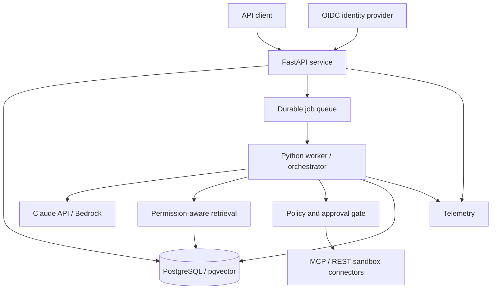

# Project Atlas — Master Specification v2.0

## 1. Charter
A 43-week, 344-hour (338 planned curriculum hours plus 6 hours of scheduling reserve) Enterprise Applied AI Engineering & Developer Enablement residency focused on customer-facing, code-first enterprise AI engineering. Build one evolving enterprise system, not disconnected exercises. The fictional engagement is not an account of any specific company's internal practices.

**Principle: Build for understanding. Adopt for production.** Prioritize backend and systems engineering; use professional tools without unnecessary subscriptions. Planning budget $500–1,000, not a hard cap. Review actual cloud and inference spend weekly.

## 2. Customer brief
Meridian Financial Group (fictional): 12,000 employees, 800 engineers, AWS infrastructure, Okta identity, ServiceNow tickets, Confluence knowledge, GitHub repositories, Slack, Workday. All data and credentials used in Atlas are synthetic or dedicated sandbox credentials. Stakeholders: CTO (business outcomes), platform lead (operability), security lead (access and audit), IT operations lead (workflow quality).

Primary workflow: investigate a simulated payment-service incident, retrieve authorized runbooks, inspect synthetic telemetry and tickets, produce evidence-backed recommendations, without modifying source systems in V1. Ticket mutations and approval workflows remain a separately authorized later sandbox phase. No real production remediation, financial transactions, or employee data. Stretch workflow: access request with human approval. Do not implement additional workflows until the primary one meets its acceptance gates.

### Discovery baseline
Payments Platform is the initial pilot (32 engineers, 12 juniors, approximately 180 incidents/month across all categories). Select 3–4 low-complexity categories in technical discovery. Datadog provides telemetry; ServiceNow remains authoritative. Enforce read-only access outside the model; authorize output writes separately. Abstain or escalate insufficient evidence and out-of-scope cases; no temporary workaround recommendations in V1.

Provisional junior-engineer targets: diagnosis 48 to 31 minutes (35.4% reduction); resolution 112 to 95 minutes (15.2% reduction). Validate category-specific baselines. Shadow incidents with point-in-time evidence, independent senior review and staff adjudication, then controlled pilot. Separate improvement and validation cases. Initial 15–20 cases are a checkpoint, not a release gate. Confirm categories, triggers, delivery, accuracy, latency, sample size, security, integration and budget in technical discovery.

## 3. Requirements and acceptance criteria
| ID | Requirement | Acceptance test |
|---|---|---|
| F1 | Submit incident investigation via API | Valid request returns a traceable run ID; invalid input returns 4xx |
| F2 | Claude tool execution | Typed tool schemas; bounded loop; unknown tools rejected |
| F3 | Evidence retrieval | Responses cite authorized document IDs; missing evidence is acknowledged |
| F4 | Durable execution | Restart worker mid-run; recover persisted state without duplicate external writes |
| F5 | Approval | No mutation without authenticated authorized approval tied to exact action payload; expiry and replay tests |
| F6 | Identity and access | OIDC tokens validated with established libraries; cross-tenant and role denial tests |
| F7 | Audit | Record actor, run, tool, approval and outcome; redact secrets and sensitive content |
| F8 | Operational visibility | Correlated traces, latency, queue depth, error and token cost metrics |

Platform capacity benchmark, not pilot demand or customer release gate: design for a hypothetical 50,000 requests/day (~0.58 requests/sec average); benchmark a 10 requests/sec burst with mocked inference, then a small separately budgeted real-model test. Initial engineering targets: API job acceptance p95 <500 ms under that mock workload; zero duplicate ticket writes in replay tests using a mock idempotent downstream; zero unauthorized writes in security test suite; at least 85% task success on 40 held-out synthetic cases. These are proposed targets, not demonstrated results or production guarantees. Measure end-to-end latency separately; report model and tool latency, cost and failure rates. No claim of regulatory compliance.

## 4. Architecture and stack
Start with a modular Python service, not microservices. Target topology:

Baseline: Python, uv, Ruff, FastAPI, Pydantic, httpx, Anthropic SDK, pytest, GitHub, VS Code, Docker Compose. Add PostgreSQL, SQLAlchemy and Alembic, pgvector, Redis or Valkey, Keycloak, MCP Python SDK, WireMock or Python mock APIs. Later: SQS, ECS Fargate, RDS, IAM, Secrets Manager, CloudWatch, Terraform/OpenTofu, GitHub Actions, OpenTelemetry, Prometheus/Grafana, Langfuse or Promptfoo, Locust, Trivy. Use an embedding provider or local embedding model; Claude generation API is not assumed to supply embeddings. LangGraph and Temporal are candidates, not mandatory dependencies; evaluate alternatives against actual requirements. Kafka and Kubernetes are optional experiments only if justified. Check licenses, pricing and compatibility before adoption.

Local development and staging use synthetic services and containers; AWS staging deployment is short-lived, budgeted, and torn down after demonstrations. Never expose local databases publicly. Use least-privilege IAM, TLS, secret injection, encrypted storage and separate environments. AWS budget alerts are not hard spending caps.

Add a provider interface and actual Amazon Bedrock integration alongside direct Anthropic API inference. Compare authentication, quotas, streaming, availability, cost, errors and telemetry; use sandbox IAM and budgeted smoke tests. Configure Claude Code with Bedrock where supported. Verify current product capabilities against official documentation.

## 5. Engineering ownership
| Independently implement first | Adopt or compare later |
|---|---|
| Async API, validation, error mapping, client wrapper | FastAPI and official SDK remain foundations |
| Repository layer, transaction boundaries, migrations | SQLAlchemy / Alembic |
| Bounded agent loop, tool registry, state transitions | LangGraph if warranted |
| PostgreSQL job claiming, leases, retries, idempotency | SQS with explicit delivery semantics |
| Durable workflow state and approval transitions | Temporal if warranted |
| Atomic rate limiter and cache policy | Redis/Valkey or gateway controls |
| Retrieval ingestion, ranking and ACL filtering | Retrieval libraries if warranted |
| Policy checks, evaluation runner and trace instrumentation | Established security libraries, Promptfoo/Langfuse, OpenTelemetry |

Do not reinvent cryptography, JWT protocols, databases, brokers, inference engines or container runtimes. Educational implementations are sandbox-only until tested and reviewed. Keep before/after benchmarks and ADRs. No assumption that every custom component must be replaced.

## 6. Engineering standards
Repository layout: `src/atlas/{api,domain,agents,tools,retrieval,storage,workers,security,telemetry}/`, `tests/{unit,integration,e2e,security}/`, `evals/`, `infra/`, `mocks/`, `docs/adr/`, `docs/runbooks/`, `scripts/`. Root README, pyproject.toml, .env.example, .gitignore, compose.yaml. Start with only directories actually needed.

Each PR includes a problem statement, acceptance tests, trade-offs and failure behavior. CI runs lint, type checks, tests and secret scanning. No real customer data, keys, or employer code. Treat model outputs and retrieved content as untrusted; enforce authorization outside the model, validate tool arguments, restrict egress, bound execution and require approvals for mutations. Persist audit records and use correlation IDs. Use a transactional outbox or reconciliation where appropriate; do not claim exactly-once delivery across independent services.

AI usage: learning mode for core components (mentor, hints, review; no generated implementation); collaborative mode for debugging and design; professional mode for repetitive configuration. Initial allocation 50/30/20 of coding time. Explain and modify every merged core component without AI assistance.

## 7. Roadmap — one repository, one engagement
Each calendar week consists of four two-hour sessions (8h total). Default: sessions 1–2 implementation; session 3 design and targeted reading; session 4 Claude Code, enterprise enablement and customer engagement. Rebalance sessions across milestones to preserve the original 260 engineering hours and 78 enablement hours; reserve 6 hours for scheduling. The roadmap below uses curriculum units, not calendar weeks; each unit represents approximately 13 hours of combined work. Complete units in order, with flexible pacing and verified exit criteria. Unit 1 includes 10 hours of original assignments and may span two calendar weeks.

| Curriculum unit | Customer assignment | Evidence / exit criterion |
|---|---|---|
| 1 | Discovery and walking skeleton | Charter, context diagram, health endpoint, test and CI |
| 2 | Integrate Claude | Async client, timeouts, mocked tests and one live smoke test |
| 3 | Investigate incident via tools | Typed registry, mock ticket/telemetry APIs, bounded agent loop |
| 4 | Demonstrate first workflow | End-to-end read-only demo, initial eval cases, architecture review |
| 5 | Persist investigations | Schema, migrations, transaction and restart tests |
| 6 | Retrieve runbooks | Ingestion, embeddings, pgvector, evidence citations |
| 7 | Standardize integration | MCP server/client, connector failure tests |
| 8 | Restrict access | OIDC, RBAC, document ACLs, cross-tenant tests |
| 9 | Diagnose pilot bottlenecks | Locust baseline, profiling, query plans |
| 10 | Control load | Cache and atomic rate limiting; concurrency tests |
| 11 | Handle long jobs | PostgreSQL queue, worker leases and status API |
| 12 | Survive failures | Retry, dead-letter, idempotency tests; compare SQS |
| 13 | Persist workflow transitions | Explicit state machine, restart/resume tests |
| 14 | Coordinate tools | Dependency handling, cancellation, bounded parallelism |
| 15 | Approve mutations | Approval binding, expiry, replay and authorization tests |
| 16 | Review orchestration | Compare native implementation with LangGraph/Temporal; ADR |
| 17 | Measure quality | Held-out eval dataset, deterministic checks, judge calibration |
| 18 | Red-team system | Injection, access bypass, secret leakage and audit tests |
| 19 | Optimize cost and latency | Token budgets, caching/routing experiment, report |
| 20 | Operational readiness | Traces, dashboards, alerts and incident drill |
| 21 | Deploy to AWS | IaC, IAM, networking, ECS, database and queue |
| 22 | Automate releases | CI/CD, secret management, rollback demonstration |
| 23 | Validate failure and load | Fault injection, load report, recovery runbook |
| 24 | Customer handoff | Demo, architecture defense, acceptance report, teardown |
| 25–26 | Buffer and remediation | Close critical gaps, independent coding/system design assessment |

Start evaluation and security in the first four curriculum units; later units deepen rather than introduce them. Do not run large real-model load tests. Reading: Fluent Python (async and typing); Designing Data-Intensive Applications (transactions, replication, delivery); Anthropic Building Effective Agents and API docs; AWS Builders' Library; AI Engineering by Chip Huyen. Read selectively against active assignments.

### Additive developer enablement workstream
Target Technical Architect alongside Applied AI Engineer, FDE and Applied AI Architect. Preserve all original engineering assignments and independent implementation rules. After the first successful prototype, simulate a separately approved Meridian Claude Code adoption engagement using Atlas as the reference repository; this is not yet an agreed customer requirement.

| Curriculum units | Additional focus | Evidence |
|---|---|---|
| 1–4 | Finish discovery; introduce Claude Code in Unit 2, instruction hierarchy, permissions | Governed local setup; workshop 1: Claude and agentic engineering |
| 5–8 | MCP, hooks, skills, subagents, plugins; rapid prototype | Reusable integration demo; workshop 2: MCP |
| 9–12 | Bedrock, headless CI, context management, agentic debugging and developer productivity | Provider comparison and live smoke test; workshop 3: Claude Code workflows |
| 13–16 | Enterprise administration, SAML/OIDC/SCIM, retention, connectors, spend controls, audit and governance | Governance guide; workshop 4: secure adoption |
| 17–20 | Evals, debugging, product feedback and technical champions | Reproducible feedback report; workshop 5: evaluation and debugging |
| 21–24 | Phased rollout, train-the-trainer materials and public portfolio | Adoption plan; workshop 6: enterprise enablement |
| 25–26 | Buffer and assessment | Close gaps; extend duration rather than cut engineering depth |

Each workshop includes working live demo, exercises, troubleshooting, unexpected questions and deliberate failure recovery. Record practice where feasible. Time-box rapid prototypes using authorized Collaborative or Professional Mode on non-protected tasks only. Preserve AGENTS.md and CLAUDE.md mode rules. Develop facilitator guides and proficiency checks. Measure adoption, quality and productivity without assuming causation. Produce sanitized technical articles, workshop repository, recorded demo and architecture/evaluation case studies; publish only with approval. Document product limitations with reproduction, impact and workaround. Refresh relevant Claude product knowledge against official documentation. Distinguish simulated enterprise controls from actual administration; commercial access may be unavailable. No compliance claims or employer data. Added budget is 78 learning hours, not a guarantee of completion.

## 8. Competency assessment
Every four weeks, score 0–3 (0 cannot explain, 1 explains with help, 2 independently implements, 3 independently diagnoses and defends trade-offs) for Python/backend, data, distributed systems, AI integration, security, reliability and architecture communication. Record evidence, not guessed proficiency. Monthly assessment: 30-minute no-AI coding task, 30-minute design defense, one failure diagnosis. Target by curriculum unit 24: level 2 or better in all core categories; level 3 in several. Completion does not guarantee senior SWE or frontier-lab interview readiness.

Add evidence-based 0–3 assessments for Claude Code, enterprise administration, technical teaching, rapid prototyping, developer enablement and product advocacy. Level 2 means independent execution; level 3 independent diagnosis and defense of trade-offs. Final evidence: governed developer environment, timed prototype, 30-minute workshop with unexpected questions, adoption strategy defense and actionable feedback report. Seek real presentation opportunities separately; simulation is not equivalent to real production or audience experience.

## 9. Unit 1 — first customer assignment
**Customer request:** Demonstrate that a proposed Claude-based incident investigation service can fit our environment. Do not write to enterprise systems. We need a reviewable architecture and an executable service skeleton before authorizing further development.

| Task | Time | Acceptance criteria |
|---|---:|---|
| Discovery | 1h | Complete one-pager and technical discovery; confirm requirements, actors, trust boundaries, incident inputs and outputs |
| Design | 2h | Draw context diagram; ADR-001 explains modular monolith vs microservices; define API contract |
| Repository setup | 1h | Git repository, uv, Python version pin, README, .gitignore, env example, Ruff, pytest |
| Backend skeleton (independent) | 3h | FastAPI app, GET /health, POST /v1/investigations returning deterministic stub, Pydantic validation and structured errors |
| Tests and CI | 2h | Happy path, invalid request, health check; GitHub Actions runs lint and tests |
| Review | 1h | Run locally, demonstrate curl requests, explain request lifecycle and identify next risks |

Do not add a database, Redis, agent framework, UI or AWS deployment during this unit. Define interfaces only where the first use case requires them. The stub is intentional; real Claude integration is Unit 2. First deliverable: independently authored one-pager at `docs/architecture/001-customer-discovery.md`. Complete outstanding technical discovery before architecture approval and implementation. Preserve `docs/discovery/ATL-001-customer-discovery-transcript.md` unchanged. Discovery time is an estimate, not a completion gate. Mentor reviews decisions rather than supplying core code.

### Definition of done
A fresh clone can run tests and start the service using documented commands; CI passes; no secrets committed; API contract and design decisions documented; you can explain every core line. Record open questions and next-session backlog.

## 10. Change control
v2.0 changes pacing to four two-hour sessions weekly over 43 weeks, preserves the original 260-hour engineering curriculum, adds 78 hours of enablement, integrates Bedrock and reconciles initial discovery. Preserve v1.0 in version control. ATL-001 remains in progress; update backlog and progress only after verified completion. This specification is a living baseline. Update requirements and ADRs as customer constraints evolve; keep one coherent system. Proposed tools, targets, budget and customer details are design assumptions to validate, not verified facts about any real financial institution.
